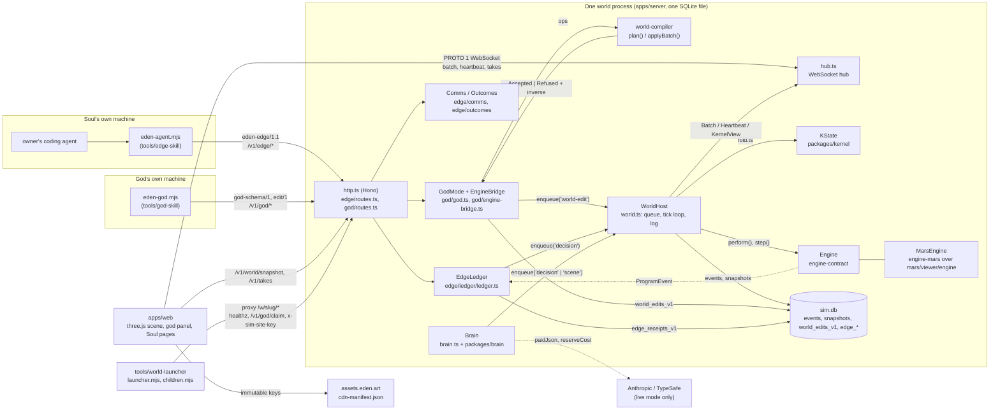

# Component and data-flow map

The actual things: the classes, concepts and contracts that make up a Sim world, and how data moves between them.
[architecture.md](../architecture.md) is the overview by component; this page is the map by *seam*, for reasoning about
contracts, performance and where a feature would plug in. Every claim below was read from the code at the paths given;
where the code and an older doc disagree, the code is quoted and the doc is named.

## 1. The component graph



Solid edges are the contracts named in §10. The dotted edges are the two paths that are easy to misplace: model calls
never touch the engine (they end as logged events), and the engine's `ProgramEvent`s are what turn a Soul's act into
a receipt.

## 2. The world process

One world is one Node process, built in `apps/server/src/main.ts`: a `Db` on `$DATA_DIR/sim.db` (`main.ts:69`),
a `WorldHost` (`:98`), `Auth`, `Brain`, `Souls`, `Hub`, optional `IntentControlV2`, `EdgeLedger` (edge mode only,
`:149`), `GodMode` (`:153`), `GroundHost`, `EngineBridge`, and the Hono app from `http.ts`.

**Who owns what.** Three state owners share the process, and only `WorldHost` may change two of them:

| Owner | State | Where |
|---|---|---|
| `Engine` (physics, "depiction") | `WorldState` (entities, regions, env, RNG), running `ActionRecord`s, programs, takes | `packages/engine-contract/src/engine.ts:87`; Mars: `packages/engine-mars/src/engine.ts:193` |
| `KState` (meaning) | `things`, `links`, `vocab` (kinds, link kinds, cards, manners), `decks`, `nextId` | `packages/kernel/src/types.ts` |
| `WorldHost` (sequencer) | `minds: Map<soulId, Mind>` (intent, agenda, mood, `pending` card), `seq`, `clockRate`, `extra` (adopted rules/policies), the input queue, the batch ring | `apps/server/src/world.ts:126-176` |
| Server modules, outside the fold | god entity model (`world_entities_v1`, `world_defs_v1`), edge receipts, comms streams, accounts, Soul `now` lines | `god/store.ts:40-87`, `edge/ledger/ledger.ts:295`, `edge/comms/store.ts:10-26`, `accounts/store.ts`, `soul-now.ts` |

**The input queue.** `WorldHost.enqueue(kind, author, payload)` (`world.ts:658`) pushes a `Pending` onto a plain array
and returns a Promise that resolves with the logged event. Variants: `enqueueChecked` adds a synchronous
`AcceptanceGuard` (re-checked at drain time, never replayed), `enqueueObjectDecision` journals a private row in the same
SQLite transaction, `enqueueIntentDecision` previews program admission on a restored engine copy. The `EventKind` union
(`packages/protocol/src/index.ts:73`) has 29 kinds: `birth`, `intent`, `mandate`, `decision`, `edge-stop`,
`edge-relocate`, `edge-god-walkout`, `edge-attention`, `body-assignment-v1`, `world-edit`, `play`, `mint`, `deck`,
`scene`, `rules`, `admin`, `retire`, the `intent-*-v2`/`v1` family and the `station-*` family. Ordering is strictly FIFO
across all authors (`this.queue.splice(0)`); there is no per-Soul fairness, so one Soul's burst is logged ahead of
everyone else's inputs for that tick.

**One frame, in order** (`frame`, `pumpFrame`, `tickOnce`, `drainInputs`: `world.ts:432-612`):

```mermaid
sequenceDiagram
  participant T as setInterval(TICK_MS / pace)
  participant H as WorldHost
  participant DB as sim.db
  participant K as KState (fold.ts)
  participant E as Engine
  participant L as listeners (Brain, EdgeLedger, EngineBridge, Hub)
  T->>H: frame(): due = floor(carry); cap 40; dilate after 3 overruns
  loop one tick per setImmediate
    H->>H: drainInputs(): queue.splice(0)
    H->>DB: appendEvent(seq+1, tick, kind, author, payload)
    H->>K: apply(e) → foldEvent: applyAll(kernel changes)
    H->>E: perform(program) for decision; applyWorldEditV1 for world-edit
    H->>E: step() → {paths, changes, events, programs}
    H->>H: advanceLives(); sweep(kernel); afterPrograms(programs) → enqueue('play')
    H->>L: onRuntimeEvent, afterTick(tick)
    L-->>H: enqueue(...) for the next tick
    alt tick % 10 == 0
      H->>L: onBatch(Batch) → hub broadcast
    end
    alt tick % 100 == 0
      H->>L: onHeartbeat({viewHash, 8 keyframes})
    end
    alt tick - lastSnapshotTick >= SNAPSHOT_EVERY_TICKS
      H->>DB: schedulePeriodicSnapshot(): capture now, encode + write in 4 ms setImmediate slices
    end
  end
```

Constants: `TICK_MS = 50`, `BATCH_TICKS = 10`, `HEARTBEAT_TICKS = 100`, `RING_BATCHES = 600` (`world.ts:120-123`);
`SNAPSHOT_EVERY_TICKS` default 6,000 (`config.ts:61`); `pace` is 1 while watched, `SIM_UNWATCHED_PACE` (default 0.25)
otherwise (`attention.ts:16-19`), and pace is not logged. Overrun handling halves `clockRate` to no lower than
`baseRate/4` and logs a `rules` event `{clockRate, why:'dilation'}`; 200 calm frames double it back (`world.ts:449-452`).
A listener's `enqueue` during `afterTick` lands in the next tick, except under `durableClockV1` (Eden core worlds) where
`drainInputs()` runs a second time before the frontier is persisted (`world.ts:497`).

**Replay.** `fold.ts` is the single fold used live, at restart and in tests: `boot()` loads the latest row of `snapshots`
(engine runtime + minds + kernel + `extra`, `SnapshotBody`) and re-applies later `events` rows. `replayKernel` rebuilds
`KState` from the log alone with the world's *pinned* vocabulary (the first `rules` event carrying `vocabulary`), never
the code's current one (`fold.ts:20-33`). The engine replays because every body movement started from a logged
`decision` and continues deterministically inside `Engine.step()`.

**SQLite layout** (`migrations.ts`, plus module-owned tables): canonical `worlds`, `events (world_id, seq) PK`,
`snapshots (world_id, tick) PK` with `state_hash`/`physical_hash`, `souls`, `users`, `paid_costs`,
`clock_frontiers_v1`; god `world_meta_v1`, `world_defs_v1`, `world_entities_v1`, `world_edits_v1`, `god_tokens_v1`,
`god_builds_v1`; edge `edge_receipts_v1`, `edge_outcomes_v1`, `edge_comms_*` (stream, speech, conversations, turns,
objects, work), `edge_items_v1`, `edge_follows_v1`; takes `take_chunks`, `take_archives`; intents
`intent_requests_v2`, `intent_observations_v2`, `intent_arrivals_v1`. The shared `accounts.sqlite` (one per launcher
stage) holds only `provider_accounts_v1` (`account-registry.ts`).

## 3. The engine seam

`Engine` (`packages/engine-contract/src/engine.ts:87`) is what the host, brain and clients may ask of any engine:
`rulesVersion`, `dt`, `schema`, `runtime: RuntimeView`, `world: WorldState`, `describeVerbs()`, `stateHash()`,
`physicalHash()`, `step()` returning `{paths: PathCommit[]; changes: ChangeEvent[]; events: RuntimeEvent[]; programs:
ProgramEvent[]}`, `perform(Program): ProgramAdmission`, `stop`, `canPerform`, `programOf`, `snapshot`,
`spawnHuman`, `removeEntity`, `enumerateActivities`, `describeSurroundings`, `anchors`, `poseSampleOf`,
`currentPath`, plus about sixty optional `preview*V1` / `adopt*V1` hooks for logged transitions. `EngineFactory`
(`:218`) is `{rulesVersion, genesis(seed), create(world), restore(snap), canRestoreSnapshot?, canReplayHistory?,
validateHistoryHead?}`. `Runtime` (`runtime.ts`, `DT = 1/20` at line 8) steps live `ActionRecord`s in id order then
runs invariants; `ActionDef<Params, Program, Exec>` (`actions.ts`) has `plan`, `start → Exec`, `step(rt, exec, dt)`,
`cancel`, `serializeExec`/`restoreExec`: an `Exec` is in-flight state that must serialize at any tick.

**Determinism.** `hashOf = sha256(stableStringify(x))` (`hash.ts`); the RNG is sfc32 with its state in `world.rng`
(`rng.ts`), and the core has no `Date.now`, `Math.random` or DOM (`mars/AGENTS.md`). `conformance.ts` checks: same seed
same hash, different seeds diverge, snapshot/restore mid-action continues identically, `physicalHash` ignores labels and
env, unknown verb returns `action.unknown-verb`. Note the host's `LogEvent.at = Date.now()` is wall time *outside* the
engine and is not hashed.

**Why bodies keep moving between inputs.** A `decision` becomes a `Program` (ordered engine verbs) via
`engine.perform` (`fold.ts:101-106`); `MarsEngine.step()` (`engine-mars/src/engine.ts:294`) then advances every program
each tick (`for (const p of this.programs.values()) this.advance(p)`), walks continue inside the Mars `Runtime`, and
the adapter cuts a take every 20 ticks and emits a keyframe `PathCommit` every `KEY_EVERY = 5` ticks. Between agent
inputs, `EdgeLedger.afterTick` (every 20 ticks) runs `ambientLife` and `BodyRule.sweep`, each of which may
`enqueueChecked('decision', 'edge:<id>', …)` with triggers `edge-ambient` / `edge-body` (`ledger.ts:201,560`).

**Three implementations.** `engine-toy` (`ToyEngine`, `engine-toy/src/engine.ts:37`) is the small reference engine for
tests and the `toy` world. `engine-mars` (`MarsEngine`) lazily imports `mars/viewer/engine/*` (`load.ts`), installs
Node's SHA-256 (`hashes.setSha256Provider`), lowers the shared body verbs (`BODY_VERBS`: walk_to, sit, rest, wave,
converse, gather, …) to Mars ops in `lower()` and passes raw Mars verbs through as `mars:<verb>`. **`engine-native` is
not an engine**: it holds humanoid stair qualification and lifecycle/crew-removal factory wrappers around `MarsEngine`
configs (`engine-native/src/*`). `packages/conformance` is likewise not an engine suite but a library-def sweep over
the world compiler's `coreLibrary` with append-only pinned findings in `packages/conformance/conformance/*.json`.

## 4. Kernel and world compiler

**Kernel** (`packages/kernel`): `Thing {id, kind, name, traits, states, at, born, by}`, `Link {kind, from, to, value?,
data?, since, until?}`, and `Change`, a union of **seven** ops (`appear | vanish | set | move | link | unlink | say`;
the file comment still says five, `types.ts:6,33`). `check(s, c, by)` throws `Refused {code}` under the coherence rule
(an actor changes only itself, what it controls, what it made; speech links only from `say`), `apply` mutates,
`applyAll` is the atomic batch, `sweep` drops lapsed links (`kernel.ts:20-126`). `Card` (`cardSchema`: target, derive,
when ≤ 8, then ≤ 8, approach, during, wants, takes) and `Playable = {card, target, id}` live in `cards.ts`; `Step` is
`z.infer<stepSchema>`. The kernel owns no physics: `initKernel` mirrors the engine's `anchors()` as place Things
(`fold.ts:38-47`), and a `play` event applies a card's `changesOf(...)` to the kernel after the engine has run its
approach steps (`world.ts:617-656`, `fold.ts:156`).

**World compiler** (`packages/world-compiler`): `plan(world, input, by, tick, opts)` works on `world.fork()` and returns
`{ok:true, apply(), ids, warnings, diff} | {ok:false, failures}`; `applyBatch` returns `{result: Accepted|Refused,
diff?, inverse?: Op[]}` (`compile.ts:128,682`). The `edit/1` batch is `{ops ≤ 256, clientRef, note, group}`; `opSchema`
has 17 kinds (place, remove, move, set, clone, define, undefine, world, expand, answer, restore, restore-def,
revive-def, economy, mint, pay, relate; `schemas.ts:362`), of which clients may send 14. Defs are `name@version`,
content-hashed, stored under both `sha:<hash>` and ref (`model.ts:141`); redefining pushes a `restore-def` inverse.
`coreLibrary()` is one frozen process-wide `DefLibrary` built from `CORE_KIT`; a world pins a def by hash on first use.
Limits are in `packages/generators/src/creation-limits.ts` (`CREATION_LIMITS`: 20,000 entities, 10,000 defs, 50 M tris,
1,024 solids per region, 256 ops per batch). `@sim/generators` (kit, buildings, roads, clearance) and `@sim/ground`
(terrain tiles, `settle`) are used by the compiler, the server and the web app alike.

## 5. Minds

`BRAIN_MODE` is `'fake'` only when the env says so; anything else is live (`config.ts:52`), and a missing API key also
forces fake (`packages/brain/src/jev.ts:32`, `narrator.ts:149`). `MIND_DRIVER` is `'edge' | 'central'`, default `edge`
(`config.ts:29`): in edge mode `Brain.afterTick` returns at once (`brain.ts:192`) and the `EdgeLedger` is built instead.
Model roles (`packages/brain/src`): **mid** (Jev, picks an `ActivityOption` id among engine-enumerated options),
**translate** (Jev → `WireIntent`), **director** (Jev, camera shots), **narrator** (Haiku, a 5-minute region `Plan` of
beats → `enqueue('scene')`), **compile** (Haiku, a wish → card agenda; also interprets intent-v2 directions), **talk**
(Haiku, speech words), reflection (Haiku, journal). Default model for the three Haiku roles is
`claude-haiku-4-5-20251001` (`config.ts:56-58`); Jev is `jev-1.13.0` at `api.typesafe.ai`.

**Budget.** `paidJson` (`paid.ts`) calls `gate(costBound(...))` before every `fetch`; the gate is `Db.reserveCost`
(`db.ts:33`), which refuses with `BudgetReservationUnavailable` when the rolling 24 h `SUM(cost)` of `paid_costs` plus
the bound exceeds `min(ceiling, budget)`. `worldThinkingBudgetV1` (`thinking-budget.ts`) allows a ceiling of 1 or 3
USD/day (3 only for the authorised Eden world); target default 0.5. `Governor` adds per-tier token buckets.

**Model output never enters the engine.** Every role returns an id among code-enumerated options or validated text,
and the result is enqueued as a `decision`, `scene` or `rules` event; `fold.ts` calls `engine.perform` from the log
(`fold.ts:3-6`). An unguided edge Soul moves only because the ledger's `ambientLife`/`BodyRule` enqueue native
decisions, none of which call a model.

## 6. The Soul edge

Every `/v1/edge/*` route resolves the Soul through `soulFromToken` and is mounted from `http.ts:94` →
`mountEdgeRoutes`. The request/response contract is `eden-edge/1` (`edge/contract.ts:9`), with boot responses
declaring the additive `eden-edge/1.1`.

| Surface | Routes | Module |
|---|---|---|
| Boot and context | `GET boot`, public `boot/static`, `boot/places`; `GET here[?include=doHere]`, `around`, `observe`, `capabilities` | `edge/boot/routes.ts`, `edge/routes.ts`, `edge/perception/here.ts` |
| Acting | `POST act` → `EdgeLedger.act` (`ledger.ts:837`); `POST resolve` (dry run); `GET receipts/:id` | `edge/routes.ts:58`, `edge/ledger` |
| Comms | `say`, `converse`, `conversations`, `objects/:id/act`, `wait` (1–55 s long-poll), `digest`, `calendar`, webhooks, steward queue | `edge/comms/index.ts` |
| Events | `GET events` (SSE), `events/ws`, `GET schema` | `edge/events` |
| Body, eyes, plans, reminders | `GET/PUT body`, `view`, `view/img/:file`, `plan`, `reminders` | `edge/body`, `edge/eyes`, `edge/plans`, `edge/reminders` |
| Outcomes | `content/catalogue`, `content/objects/:id`, `mail` | `edge/outcomes/routes.ts` |
| Owner-side | `/v1/souls/:id/intent-v2*`, `/v1/agent/intent-v2*`, inbox, `self/now`, `self/link`, `travel` | `http.ts`, `inbox-routes.ts`, `soul-now-routes.ts`, `travel/routes.ts` |

**Pairing and tokens.** A Soul token is `sim_<soulId>_<24 B base64url>`; only its sha256 is stored (`souls.token_hash`,
or `account_agent_grants_v1.token_hash` with accounts; `souls.ts:508-620`). Three flows exist: owner code
(`POST /v1/souls/:id/pair`), agent-initiated (`/v1/agent/pair/start` → browser `#pair/<code>` → `/v1/agent/pair/poll`),
and accounts (`/v1/agent/approval/start|poll` → `/v1/account/approvals/:id/approve`). Pending pairings are in memory
with a 15-minute TTL. `soul-link.ts` reduces this to `pairing | connected | disconnected`.

**Here.** `hereFrame(ledger, soul, {doHere})` (`here.ts:211`) builds a fresh `Perception` per request: clock, light,
weather, `me` (place path, pose, posture, activity, gaze, holding, fade), Souls within 30 m, objects within 15 m,
conversations in earshot, exits, floors; with `doHere` a byte-budgeted menu of ≤ 12 offered capabilities. Capabilities
come from `EdgeLedger.binds` → `readHumanCapabilitiesV1` (`human-capabilities.ts`), cached per (Soul, tick) in
`capCache`, which `act` clears on every acceptance (`ledger.ts:612,839`).

**One Soul action, CLI to render:**

```mermaid
sequenceDiagram
  participant A as eden-agent.mjs act
  participant R as edge/routes.ts
  participant L as EdgeLedger
  participant H as WorldHost
  participant E as MarsEngine
  participant Hub as hub.ts
  participant W as apps/web Replica
  A->>R: POST /v1/edge/act {capability, params, clientRef}
  R->>L: act(soul, input): binds(soul) → plan
  L->>L: INSERT edge_receipts_v1 (phase accepted)
  L->>H: enqueue('decision', 'edge:<soul>', {steps, trigger:'edge-act:<receipt>'})
  R-->>A: {accepted, receipt}
  Note over H: next tick
  H->>H: appendEvent(decision)
  H->>E: perform({actor, label, steps}) → ProgramAdmission
  loop each tick
    E->>E: step(): advance(program), walk, take recorder
    E-->>H: {paths, changes, programs: step|completed|failed}
    H->>L: onProgram → UPDATE receipt phase (started / completed / failed)
    H->>Hub: onBatch every 10 ticks, takes chunk every 20
  end
  Hub-->>W: {t:'batch'} / {t:'takes'}
  W->>W: Replica.applyBatch; takes playback moves the body
  A->>R: GET /v1/edge/receipts/:id or /v1/edge/wait
  R-->>A: receipt → outcome (edgeOutcomeV1Schema)
```

Intents v2 (`packages/protocol/src/intent-v2.ts`: `intentRequestV2Schema` op upsert/withdraw, `soul-intent/2`,
`intentOutcomeV2Schema`, `intentAdmissionPayloadV2Schema`, `intentControllerPayloadV2Schema`) are the *owner's*
direction channel: `IntentControlV2.submit` → `IntentPublisher` enqueues `intent-request-v2`, `Brain.compile`
interprets it, `intent-v2` is logged, and `host.enqueueIntentDecision` writes a `decision` plus a derived
`intent-admission-v2` fact in one transaction (`world.ts:683,734`). Mandates are kernel state (`mandate.ts`:
`foldMandate`, `MANDATE_STATE`). Lifecycle (`LifecycleJournal`, `LifecycleRunner`) creates and retires Souls through
`rules` and `retire` events when `edenCapabilities` is on. Eyes always computes a caption (`edge/eyes/sight.ts`); a
forked Playwright Chromium renders the viewer with `?eyes=1` only when `EDGE_EYES` is set.

**Continuity.** There is no server-side Soul memory runtime. The agent's own folder holds `memory/` (self, goals,
places, knowledge, lessons, ledger, schedule) via `memory-folder.mjs`; the world keeps only `edge_place_knowledge_v1`,
the ≤ 140-character `now` line (`soul_now_v1`, outside the log) and receipts. `purpose-recall.ts` / `purpose-episodes.ts`
feed only the *central* `Brain`. A continuity runtime would plug in at the CLI (`client-memory.mjs`, `client-living.mjs`)
and read `boot` + `here`, not into the world process.

**CLI.** `eden-agent.mjs` (v1.9.19) maps about forty commands (now, look, listen, here, observe, capabilities, act,
resolve, say, converse, object, wait, receipt, plan, events, view, travel, live, register, approval, pair-soul, …) onto
the `EDGE` route table (`eden-agent.mjs:45`); `live` spawns the `claude` CLI (codex or ollama as alternatives). It is
dependency-free and does not import `@sim/protocol`.

## 7. Protocol

`packages/protocol/src` is one shared wire contract for every consumer, not a browser package. Families and consumers:

| Family | Files | Consumers |
|---|---|---|
| Log events and hub messages | `index.ts`: `EventKind`, `LogEvent`, `Batch`, `Heartbeat`, `Snapshot`, `KernelView`, `ServerMsg`, `PROTO = 1`, `viewHashOf` | server (`world.ts`, `hub.ts`), `packages/client`, web |
| Intents | `intent-v2.ts`, `intent-history-page-v1.ts`, `intent-arrival-v1.ts`, `intent-sleep-stop-v1.ts` | server (19 files), web (7: `SoulHome.tsx`, …) |
| Pairing, Souls | `index.ts` `pair*Schema`, `createSoulSchema`; `soul-profile-v1.ts` | server, web pair pages |
| Mandates and owner views | `mandate.ts`, `owner-views.ts` (`steerReceiptSchema`, `ownerSoulDashboardSchema`) | server, `SoulHome.tsx`, `packages/brain/compile.ts` |
| Edge outcomes | `edge-outcome-v1.ts` (`edgeOutcomeV1Schema`) | `edge/contract.ts`, `edge/outcomes/store.ts` |
| Recorded takes | `take-chunk-wire.ts`, `take-boundary-wire.ts`, `take-entities-*`, `columns-v1.ts` | `hub.ts`, `packages/client/hello.ts`, web `WorldTakeTransport.ts` |
| Me-live, presentation, scene capture | `me-live.ts`, `presentation.ts`, `scene-capture.ts` | hub + client; web |
| Lifecycle | `lifecycle.ts`, `lifecycle-capability.ts` | lifecycle runner, `http.ts`, web |
| Body, station | `body-v1.ts`, `station-v1/v2`, `station-era-*` | `fold.ts`, hub, web score client |

Versioning is by file suffix (`-v1`, `-v2`) and by contract literals inside payloads (`soul-intent/2`, `eden-edge/1.1`,
`private-*/1`, `world-edit/1`). The three CLIs (`tools/edge-skill`, `tools/god-skill`, `tools/world-launcher`) consume
the JSON shapes over HTTP but import nothing from the package: a schema change there reaches them only through the
served `SKILL.md`/`SCHEMA.md`.

## 8. Presence

`packages/client` `Replica` holds `Snapshot` + applied `Batch`es; `applyBatch` returns false on a `seq` gap and
`Connection` resyncs; `check(Heartbeat)` compares `viewHash` at the heartbeat tick (`client/src/index.ts:17-113`).
`viewHashOf` is the first 16 hex chars of `hashOf` over sorted `[id, activity, on, pose[1], pose[3]]` rows for humans
(`protocol/src/index.ts:211`), computed by the host every 100 ticks (`world.ts:1600`). The hub's cadence is `batch`
every 10 ticks, `heartbeat` every 100, `takes` chunks every 20, `stats` every 2 s, `kernel` at most every 40 ticks when
dirty or every 200 (`hub.ts:125-138`, `world.ts:1631`); limits `MAX_PER_IP = 30`, `MAX_CLIENTS = 2000`.

`apps/web`: `main.tsx` → `page-route.ts` picks list or world; `useSim.ts` opens `new Connection(<worldPath>/ws)`
(`useSim.ts:57`); `snapshot-prefetch.ts` fetches `/v1/world/snapshot?defs=ref&cols=1` from an inline head script;
`LiveWorld.tsx` owns the three.js renderer (`:275-323`) and plays bodies from the socket's `takes` stream, with history
from `GET /v1/takes` (`WorldTakeTransport.ts`). God panel: `GodPanel.tsx` + `god-ui/`. Soul pages: `SoulHome.tsx`,
`MySouls.tsx`, `SoulDay.tsx`, `PairApprove.tsx`. Clerk via `ClerkBridge.tsx` and `LauncherRoot.tsx`. Assets resolve
through `cdn-assets.ts` (`readCdnManifest`, `manifestAsset`, `cdnFetch` with a 4 s hedge) against `src/cdn-manifest.json`
(origin path → `{key: assets/[br/]xx/<sha256>.<ext>, sha256, bytes}`), origin fixed to `https://assets.eden.art`.
`visitor-counts.ts` posts to GoatCounter by `sendBeacon`: path `/w/<slug>` or `/`, referrer origin, screen width, and
three events (`enter world`, `soul paired`, `god connected`), skipping `navigator.webdriver`, `?shot`, `skipgc` and
local hosts.

## 9. God mode

```mermaid
sequenceDiagram
  participant G as eden-god.mjs
  participant R as god/routes.ts
  participant GM as GodMode.commitBatch
  participant C as world-compiler
  participant S as god/store.ts
  participant B as EngineBridge
  participant H as WorldHost
  participant Hub as hub.ts / viewers
  G->>R: POST /v1/god/act {ops ≤ 256, clientRef, group} (or {preview: pv_…})
  R->>GM: submissionSchema, clientRef receipt, helper gate, builds.admit
  GM->>C: applySafe: applyBatch on a fork, then BUILDSAFE repairBatch (≤ 400 ms)
  C-->>GM: Accepted {seq, undoId, ids} + inverse ops, or Refused {failures}
  GM->>S: tx: recheck editSeq; write world_edits_v1, world_entities_v1, world_defs_v1
  GM->>Hub: emit {type:'edge', kind:'world-diff'} + SSE push('diff')
  R-->>G: Accepted | Refused
  GM->>B: onCommit(ids) → pending set
  Note over B: afterTick (same tick or next)
  B->>H: enqueue('world-edit', 'god', WorldEditV1 with derived physics + hash)
  H->>H: next tick: appendEvent; fold.ts applyWorldEditV1 (hash checked)
  H->>Hub: batch → Replica; viewers already drew the diff
```

`GodMode` (`god/god.ts`) owns the entity model and pairing (`pairStart` 8-char code, 15 min; `pairApprove` by admin,
first claimant or owner; `pairPoll` hands out `god_<worldId>_<b64>`, stored hashed in `god_tokens_v1`). `commitBatch`
(`god.ts:379`) is the one authoring path: schema → retry receipt → preview binding (`revision.stale`) → helper gate →
`builds.admit` → `applySafe` → walkouts → `store.commit` → `publish`. **BUILDSAFE** (`god/buildsafe.ts:212`,
`buildsafe-rule.ts` re-exporting the generators' clearance rule) tags place ops, replays the batch on a fork and appends
repair ops (nudge 0.15–1.5 m, turn, or cut a 1 m gate) to the *same* batch, so repairs are journaled and undoable.
`EngineBridge` (`god/engine-bridge.ts`) coalesces every commit since the last tick into **one** `world-edit` event per
tick (`flush()`, `:374`), and engine-originated changes (a Soul takes an item) go back the other way as trusted `move`
ops by `'engine'`, not undoable. Helpers (`god/helpers.ts`): child tokens scoped to one claim, 2 h default TTL, only
place/remove/move/set/clone/define. Preview: `pv_<hex>` kept in memory 10 min, committed with `POST /act {preview}`.
Trace: an in-memory ring of 1,024 rows; a "loop" is the same refusal three times in two minutes. Uploads are
content-addressed under `$ASSET_DIR/<sha256>.<ext>`, shared by every world on the box (`god/assets.ts`). Context views
(`god/context-views.ts`) render architectural pictures through headless Chrome under a host-wide render slot and cache
pixels in `context_views_v1`. Co-builders exist in code but are refused unless `SIM_COBUILDERS=1` (`main.ts:153`).

`tools/god-skill/eden-god.mjs` is generated by `build.mjs` from `cli.mjs` + `lib/`; its ~90 subcommands (`cli.mjs:1455`)
all speak HTTP with a Bearer token, mostly to `/v1/god/act`, `dryrun`, `preview`, `query`, `snapshot`, `undo`, `redo`.
The CLI does not run the compiler locally (it imports only `obbOverlap`), contrary to the header comment in `compile.ts`.

## 10. Platform

**Launcher** (`tools/world-launcher`): `openLauncher()` binds 4980 by default, children on 5101–5149 (`launcher.mjs:
145-146`; production uses `--range 4621-4659`, staging `4601-4619`, `deploy/install.sh`). `Registry` keeps
`<data>/worlds.json` (`world-launcher-registry/1`); templates are `worlds/templates/*.json` (`genesis/1`).
`createWorld` verifies the creator (`creator-auth.mjs` spawning `verify-creator.mjs`), applies `creation-policy.mjs`
(5 worlds per account; new accounts 2 and one per hour), then `pool.ensure` and `POST /w/<slug>/v1/god/claim` with the
creator's own token. `children.mjs defaultCommand` (`:405-454`) starts `node apps/server/src/main.ts` with
`BRAIN_MODE=fake`, empty provider keys, `ENGINE=mars`, `ENABLE_WORLD_ENGINE=1`, `WORLD_KEY=<slug>`, `DATA_DIR`,
`PUBLIC_URL`, `WORLD_PATH`, `SIM_UNWATCHED_PACE=0.25`, `SOUL_LIFECYCLE=1`, `EDGE_FADING=1`, and either
`AUTH_PROVIDER=clerk` + `ACCOUNT_REGISTRY_PATH` (with `--auth-env`) or `DEV_AUTH=1`. The launcher↔child contract is
HTTP only: `GET healthz` (boot poll), `/v1/config`, `/v1/god/status`, `/v1/world/souls`, `/v1/god/claim`,
`/v1/op/souls/*`, `/v1/op/god/*`, `/v1/site/*` with a per-run `x-sim-site-key`, plus read-only opens of the child's
`sim.db` (`worldOwner`). Idle: `SIGSTOP` after 10 min without non-passive requests or sockets, `SIGTERM` after another
60 min; LRU eviction against `maxRunning`/`minFreeMb`; restart backoff `min(30 s, 500·2ⁿ)`. Release handover is
`keeper.mjs` holding the port and `SIGHUP` handing worlds to a new launcher generation with a `/v1/config` canary.

**Auth.** `Auth` (`auth.ts`) verifies Clerk RS256 JWTs against the issuer JWKS when `ACCOUNT_AUTH_REQUIRED=1`;
`DEV_AUTH=1` accepts `dev:` tokens and refuses to start beside Clerk or an https `PUBLIC_URL`. Identity lives in the
shared `accounts.sqlite`; memberships, grants and approvals live per world (`accounts/store.ts`). `MAX_SOULS_PER_USER`
(default 20) is counted per world, not per site (`souls.ts:159,206`).

**Release and gates.** `deploy/release.sh` builds `git archive HEAD` with the web at `--base /worlds/`, build id
`we-<sha12>`, pulls assets from the CDN, `activate.sh` reloads and health-checks. Gates: `release-gate.mjs` (V1–V6),
`walk/walk.mjs` (walkability vs baseline), `bundle-budget/budget.mjs` (≥ 10 % growth fails), the Modal remote gate
once per release head. CI picks jobs from changed paths (`.github/scripts/ci-scope.mjs`).

## 11. Contracts table

| Contract | Producer | Consumers | Versioning | What breaks when it changes |
|---|---|---|---|---|
| `Engine` / `EngineFactory` (`packages/engine-contract`) | each engine package | `WorldHost`, `fold.ts`, `Brain`, `EdgeLedger`, hub | `rulesVersion` string, `DT` constant, `canReplayHistory`, conformance tests | snapshots stop restoring, replay hashes diverge, `boot()` throws `clock-frontier.rules-incompatible` |
| Event log (`EventKind`, `LogEvent`, payload schemas) | `WorldHost.drainInputs` | `fold.ts`, hub `log`, replay tools | new kinds are added, never reinterpreted; behaviour changes ship as logged `rules` facts | old worlds replay differently; `world-edit` hash mismatch logs |
| Hub wire (`PROTO = 1`, `Batch`, `Heartbeat`, `Snapshot`, takes, `columns/1`) | `hub.ts` | `packages/client`, `apps/web` | `PROTO`, `epoch` in `welcome`, hello capability negotiation (`hello.ts`) | viewers get `error proto`; resync storms on seq semantics |
| Protocol schema families (`packages/protocol`) | server | web, client, brain | `-v1/-v2` files, literals (`soul-intent/2`) | typecheck across apps; owner pages mis-parse |
| `eden-edge/1` + `1.1` (`edge/contract.ts`) and the `eden-agent.mjs` command surface | `edge/*` routes; served `SKILL.md` and CLI | every Soul's agent, world-launcher tests | additive fields only; CLI version string | every paired Soul in the wild; the CLI is downloaded from the world, so skew is per world |
| `edgeOutcomeV1Schema`, receipts (`edge_receipts_v1`) | `EdgeLedger`, `ActionOutcomes` | CLI `receipt`/`wait`, owner dashboards | `eden-edge/1.1` | agents misread success/failure |
| God surface: `edit/1` batch, `god-schema/1`, refusal codes, `eden-lock/1` | `god/routes.ts`, `world-compiler`, served `SCHEMA.md`/`LOCKS.md` | `eden-god.mjs`, god panel | `clientOpSchema`, `refusalCodes`, def `name@version` | god CLIs refuse or mis-plan; `SCHEMA.md` is already stale (9 ops listed, 14 accepted) |
| `world-edit/1` (`WorldEditV1`) | `EngineBridge.flush` | `fold.ts` → `engine.applyWorldEditV1` | payload `hash` of derived physics | replay logs hash mismatch; viewers and physics disagree |
| World JSON / templates (`genesis/1`, `worlds/templates/*.json`) | authors, launcher | `createWorld`, `GodMode` genesis batches | `genesis/1` literal | new worlds fail to create; existing ones unaffected |
| Takes (`mars-take/4`, `take-chunk-wire`, `take-boundary-wire`) | Mars take recorder, `hub.ts`, `/v1/takes` | web playback, `TakeArchive`, R2 | decoders accept `/1–/4`; hello negotiation | stored history unreadable; Eyes renders stale |
| Snapshot (`sim-mars-snapshot/1`, `SnapshotBody`) | `WorldHost.saveSnapshot`, `MarsEngine` | `boot()`, recovery recipes | `format`, `rulesVersion`, `canRestoreSnapshot` | restart replays from genesis or refuses to boot |
| Launcher ↔ world (`healthz`, `/v1/config`, `/v1/god/claim`, `/v1/op/*`, `x-sim-site-key`, env contract) | `children.mjs` | `apps/server` | none explicit; env names | worlds never report healthy; creation rollback |
| `local-worlds/1` (`__sim/worlds.json`), `account-soul-approval/1`, `travel/1` | launcher, server | web list page, CLIs | literals in `/v1/config` | world list and pairing UIs |
| CDN manifest (`cdn-manifest.json`, `tools/assets/manifest.json`) | `tools/cdn/publish.mjs` | `apps/web cdn-assets.ts`, `pnpm assets:pull`, CI | content-addressed keys, immutable | missing media in CI and in the viewer (never a wrong byte) |
| Conformance pins (`packages/conformance/conformance/*.json`) | library def revisions | `conformance.test.ts`, remote gate | append-only supplements | gate fails until a supplement is added |

## 12. Hot paths and known bottlenecks

Everything below runs on the one Node thread of the world process; "tick" means inside `tickOnce`, "request" means a
synchronous handler that delays the next frame.

| # | Where | Thread | What it does | Evidence |
|---|---|---|---|---|
| H1 | `MarsEngine.step()` | tick | lists the entity table (~4,500 entries on Eden 2026, "over a quarter of an idle tick" before S1 r2), steps carriers, runtime, programs, take cut | `engine-mars/src/engine.ts:294-320` |
| H2 | `EdgeLedger.binds` → `readHumanCapabilitiesV1` | request | iterates every `engine.anchors()` and verb, all minds, all entities (campfire scan), all regions; cached per (Soul, tick) but cleared on every accepted act | `ledger.ts:612`, `human-capabilities.ts` |
| H3 | `hereFrame` / `Perception` | request | rebuilt per `here`, `around`, `boot`; `things()` scans all `w.entities`, `solids()` maps all `navV1.solids` | `edge/perception/here.ts:27,211` |
| H4 | `buildLedgerBoot` | request | static boot pack rebuilt per request (ETag, no stored cache) | `edge/boot/routes.ts`, `boot-pack.ts` |
| H5 | `EdgeLedger.afterTick` | tick, every 20 | `ambientLife` (a `db.soul()` read per mind + all open conversations), `BodyRule.sweep`, `together.sweep`; `unstick` every 100 | `ledger.ts:501-520` |
| H6 | `EngineBridge.afterTick` | tick | `flush`, `writeBack` slices every 10 ticks, `perceiveStep`, `spotsStep`, `layersStep`, `navStep` while nav is cold | `god/engine-bridge.ts:217` |
| H7 | `viewHash()` + `kernelView()` | tick, every 100 / 40 | hashes every human's pose; clones the whole kernel for broadcast | `world.ts:1594-1631` |
| H8 | Hub join / resync | request | `snapshotView()` clones all entities + `JSON.stringify`; `holdClock` parks the frame while a join set goes out | `hub.ts:206-242`, `world.ts:429` |
| H9 | Periodic snapshot | tick + slices | synchronous capture, then encode/serialize/write in 4 ms `setImmediate` slices; a failed checkpoint stops the clock | `world.ts:1700-1760` |
| H10 | Frame budget | tick | ≤ 40 ticks per frame, 1 s elapsed cap, dilation to `baseRate/4` after 3 overruns | `world.ts:443-452` |
| H11 | Heap | process | `--max-old-space-size=768` from `--world-heap-mb 768` in both deploy units | `production.mjs:127`, `deploy/install.sh:24,33` |
| H12 | Context views / Eyes | request → subprocess | headless Chrome renders under one host-wide render slot; sheets in a worker thread | `god/context-views.ts`, `edge/eyes/render-worker.mjs` |

H2–H5 are the "per-Soul context and menu rebuilt on the tick thread" cost: a world with *n* active Souls pays
H2 + H3 on every `here`/`act` and H5 for every mind every second, all between two engine steps. H1 scales with
entity count regardless of Souls. The repo's own docs state almost none of this; `docs/mars/planning-budget.md`
(`REPLANS_PER_TICK = 4`) and the S1 r2 comment in `MarsEngine.step` are the only written budget claims.

## Where this map disagrees with older docs

- [architecture.md](../architecture.md) says a Soul's action "becomes a `decision` event"; edge acts also log
  `edge-stop`, `edge-relocate`, `edge-attention` and `body-assignment-v1`, and a god commit becomes one `world-edit`
  **per tick**, not per commit (`god/engine-bridge.ts:374`).
- It says the world "makes no model calls for Soul decisions"; with `edenCapabilities`, intent-v2 directions are
  interpreted by `Brain.compile` (a Haiku call under the budget), though the resulting choice is still a logged event.
- It and [worlds.md](worlds.md) say launcher children run Clerk sign-in; children get `DEV_AUTH=1` unless the launcher
  was started with `--auth-env` (production is, staging is not: `deploy/install.sh:24,33`).
- "There are no co-builders": the code path exists behind `SIM_COBUILDERS=1`, off by default.
- [souls.md](souls.md) names one pairing flow and a two-minute listen grace; three flows exist and
  `SOUL_LISTEN_GRACE_MS` is 60 s (`inbox.ts:40`).
- `packages/engine-native` is not a third engine, and `packages/conformance` is not the engine conformance suite (that
  is `engine-contract/src/conformance.ts`).
