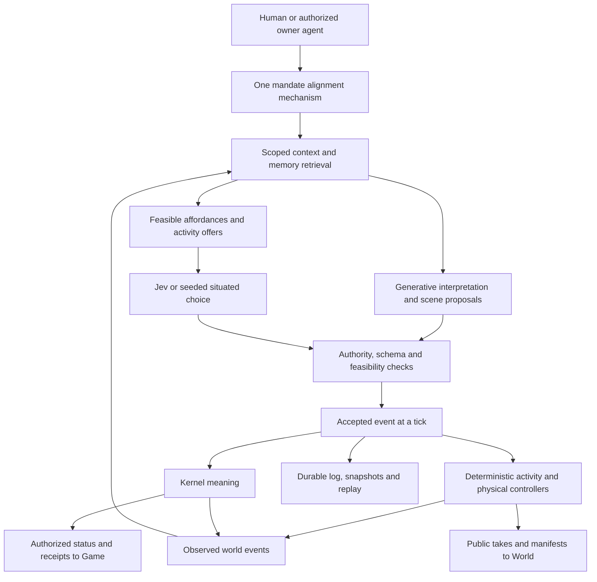

# Eden: from human purpose to a living, changing world

Core proposal for Gene to relay to Sim PM. Researched October 3 EDT / October 4 UTC, 2026.
Source: `621af25689d50e1fd10ff9bd236d0d5c70e20e15`; worktree `<worktrees>/core`.
Status: design proposal, not an implementation, agreed contract, benchmark or release.

**Recommendation:** expand the middleware that connects purpose to action. Keep
the deterministic kernel, physical engine, recorded decisions and human ownership.
Add composable activities, spatial affordances, durable personal experience,
negotiated group scenes and an inexpensive generative layer above Jev. Start with
terrain, water and boats in Eden; use those activities to develop the general
interfaces rather than waiting for a complete controller replacement.

The eventual experience: tell a Soul, “Make the riverside welcoming to shy
newcomers, but leave room for your own explorations.” It remembers particular
people, notices an awkward arrival, walks beside someone while talking, invites
a small boat outing, changes its plan when another resident declines, and later
helps build a sheltered landing. Other Souls bring their owners' purposes.
Their contributions produce a shared occasion and lasting changes nobody
specified in advance. We can explain its causes and replay its consequences.

This proposal takes Gene's willingness to double the allowance as a proposed
**$2 per world per rolling real 24 hours ceiling**. Running settings stay at
$0.50 and the code clamp stays at $1 until an approved implementation changes
them. All new landscapes and aquatic demonstrations target Eden; reusable
engine improvements preserve Mars, Little Martians and Toy compatibility.

Companion documents: [source and research evidence](intentful-world.RESEARCH.md),
[budget assumptions and calculations](intentful-world.BUDGET.json), and
[short PM handoff text](intentful-world.PM-MESSAGE.md).

## 1. What the current system actually limits

The engine is richer than the living action menu. Its single native registry
includes construction, food preparation, eating, gardening, sleep, reading,
chess, workshops, music, classrooms, tours, paired walks and vehicles. These
activities already use validated plans, claims, child actions, phases, refusal
reasons and controlled exits. Some layer behavior already exists: eating can
retain seated posture, and group controllers coordinate child actions. We should
reuse these mechanisms.

The limitations are concentrated at their joins:

| Boundary | Current source | Consequence |
|---|---|---|
| Purpose → options | Cards from a personal deck; ranked `(card,target)` pairs; 12 options normally, **24 for living Souls**; normally three targets per card | Useful actions may exist but never reach the mind. Construction alternatives can crowd out other purposes. The docs still say twelve universally. |
| Choice → execution | One `Program` per actor, sequential `steps`; a new program replaces the old one | General walk-and-talk and other independent channels cannot be expressed through this interface. |
| Native concurrency | Most actions claim `actor:<id>` exclusively; special composites handle exceptions | A renderer blend alone cannot make simultaneous actions authoritative or safe. |
| Place → reasoning | Anchor is region/place, optional entity or x-z point; `at` is one Thing reference; reference resolution follows at most six ancestors; `samePlace` uses immediate place equality | A balcony, forest trail, shore, boat seat and occupied room need more specific physical context. |
| State → mind | Eight nearby entries, three recent actions, four needs, current journal, mandate, gatherings/questions/agreements | Relationships, remote commitments, remembered projects and visible opportunities are thin. |
| Will → compiler | One rule alignment; cards with bounded conditions/effects and sequential approach/during steps; triggers none/NOW/time/gathering | Free natural language collapses into narrow execution forms. Complex conditions and concurrent purposes need better representation. |
| Speech → consequences | Structured act changes meaning; generated wording is depiction, constrained to that act | Rich words cannot independently create grounded knowledge, promises or scene changes. A generated chat may supply both speakers' lines without independent decisions. |
| Reflection | One bounded 1,200-character journal after dusk; event refs and durable episodic retrieval are absent | Long-term continuity gets compressed into a short overwrite rather than a retrievable personal history. |
| AI scheduling | Jev chooses and judges pace/manner; Haiku compiles, reflects and speaks; eight calls in flight; timer/fingerprint skips | There is already a good hybrid foundation, but incomplete context invalidation and fixed tier estimates deserve qualification. |
| Evolution | New symbolic cards/kinds/links can be minted; new physical verbs cannot | A novel ritual can acquire meaning without acquiring a suitable physical expression. Unsupported motion belongs in the existing wants backlog. |

Two qualifications matter. Native `paired_walk` is a bounded authored ground
corridor with free-handed participants; it is not general simultaneous
conversation and travel. Native `purposeful_routine` and `living_intention`
remain lab activities; they must not become the persistent day driver.

Existing replay, construction and long-soak proof is valuable but bounded. The
proposal must preserve it, not turn the previous gate's recorded RED result or
unresolved replay questions into an all-green claim. Owner prompt authorization
is a demonstrated missing source check and needs the local two-owner correction
before richer private memory is exposed through the application.

## 2. The design principle: many purposes, one authoritative world

Use different machinery for different timescales:

| Layer | Job | Typical cadence | Authority |
|---|---|---|---|
| Physical controllers | Support, routes, contacts, movement, water transitions, manipulation | Existing 20 Hz fixed ticks | Deterministic engine |
| Activity execution | Phases, reservations, joins/exits, compatible channels, completion | Tick events and guard changes | Validated activity instance |
| Situated choice | Continue, switch, respond, join, decline, manner | Events plus affordable adaptive reevaluation | Jev or seeded code, accepted through log |
| Interpretation and imagination | Understand a new purpose; propose a conversation, finite scene or useful recipe | Novelty, uncertainty, meaningful change | Generative model proposes; code admits |
| Personal continuity | Retrieve experiences; reflect on tendencies and unfinished commitments | Retrieval per relevant decision; reflection after experience | Private, evidenced, logged Soul memory |

The high-level model is allowed to be imaginative. It is not allowed to invent
physical success, another Soul's consent, a relationship that never happened or
authority its caller does not possess. Every proposed effect has a supported
lowering, a truthful refusal or a missing-capability receipt.



There is no daily timetable, routine object, daily task list or scripted fate.
A finite recipe for boarding a boat is execution mechanics. A Soul deciding to
take the boat again tomorrow is a fresh situated choice. A remembered tendency
can influence it without becoming an executable repetition.

## 3. Expand verbs through capabilities and affordances

Adding drink, jump, run or swim does not stretch Jev in itself. Jev selects among
caller-defined options; physical code computes feasible targets and parameter
bindings. Its documented Choice limit is 255 and it can judge several questions
against the same state. Those are interface limits, not proof that an enormous
menu will be chosen well. Keep menus relevant, compact and tested. Keep geometry,
arithmetic and time comparisons in code. [TypeSafe Choice](https://docs.typesafe.ai/primitives/choice),
[known limitations](https://docs.typesafe.ai/model-jaggedness/jev-1.13).

Adopt an **affordance**: a concrete opportunity this body can attempt here,
with a known controller, targets, prerequisites, resource claims and outcomes.
The same object can offer several opportunities. A dock offers approach, wait,
board, disembark, sit and watch; a tree offers shade and a qualified climb route;
it does not automatically offer climbing merely because a mesh looks climbable.

Initial expansion, with illustrative names rather than a committed public API:

| Activity | Minimum meaningful implementation | Important combinations |
|---|---|---|
| Drink | Reach a potable source/vessel, hold if required, consume a measured quantity, record nourishment | Sit + drink; short drink while stationary during a walk |
| Run | Existing route machinery with qualified acceleration, clearance, slope and energy cost | Run + brief call; running is not walking with a faster clip |
| Jump | Declared takeoff/landing, swept clearance, bounded arc and supported landing | Jump as a traversal segment; not arbitrary airborne posing |
| Climb | General declared handholds/footholds, reach limits, progress and safe exits | Pause and address someone where contacts permit |
| Wade / swim / tread | Water surface, bed depth, immersion, capability, route and shore transitions | Swim beside someone; talk only in permitted above-water phases |
| Boat | Dock, board, occupy seat, travel a water route, dock, disembark | Ride + talk/watch; row + talk with hands occupied |
| Hug | Independent participation, rendezvous, paired fit/contact phases, release | Greeting → hug; no claim on an unwilling/busy recipient |
| Spar / fight | Approach, range/contact envelopes, defend/strike/retreat phases and bounded outcomes | Start with sparring; injury/death/world conflict rules require a later explicit product decision |
| Crawl / crouch | Lower body envelope, support, route clearance and exit | Crawl under a structure; crouch + inspect |
| Lie / stretch | Contact surface, occupied envelope and controlled transition | Lie + listen; stretch while chatting where contacts allow |
| Point / inspect | Explicit attention and object/landmark, reachable indication | Walk + point; inspect + discuss |
| Give / receive | Item transfer with matched independent participation and hand capacity | Give a drink; exchange tools while seated |
| Help / cooperate | Role offer, compatible contribution to an existing activity, leave safely | Help dock a boat; join construction without replacing foreign work |
| Follow / accompany | Moving destination, separation/catch-up policy, stop/leave | Generalize the existing paired walk instead of duplicating it |
| Teach / learn | Shared topic/project, turn roles, witnessed explanation and retained experience | Demonstrate a task while explaining it |
| Play / sing / dance | Existing music activities, shared phase, body equivalents and legal contact envelope | Travel to join, then dance/listen/perform; distinguish sounding from animation |
| Observe / explore | A meaningful destination or question, evidence on arrival, optional report | Walk + observe; explore by boat |
| Comfort / disagree / reconcile | Grounded social acts, independent responses, relationship evidence | Conversation during another compatible task |

These are more than ten additions, but some reuse or expose existing actions.
Do not implement all before the first demo. Terrain, water and boats are first;
walk/talk, drink and basic run are useful early composition cases. Hug, general
climb and sparring need distinct physical qualification rather than another
construction-card variant.

Bodies advertise tested capabilities and explicit equivalents: ground travel,
hover travel, surface swimming, grasping, carrying, address/listen, dance, reach
and contact dimensions. A mechanical duck can waddle, paddle, listen and dance
in its own way. It cannot acquire human hands because a generic card requires
them. A floater can join a conversation and contribute an admitted non-manual
role; unsupported manual work receives a reason. A duck that is a Soul still
has a human owner. Background visual kin do not become ownerless Souls.

## 4. Combinatorics: compatible channels, not every pair of verbs

One actor can have one authoritative root-motion writer and several compatible
activities. Represent concurrency by the resources and fields an activity owns:

| Channel / constraint | Typical responsibility | Example exclusion |
|---|---|---|
| Support and contacts | Feet/seat/water support; climb grips; safe body envelope | A hug cannot override a necessary climbing grip |
| Motion | Route, root position, orientation, speed | Two activities cannot both move the actor |
| Manipulation | Left/right or family-specific effectors, items and task contacts | Rowing consumes the oar grips; presentation uses only a free hand |
| Communication | Speaking turn, recipient/topic, listening | One utterance at a time; conversation does not seize another actor's legs |
| Attention | Target and bounded gaze/orienting behavior | Body-safe/root orientation wins over a desired head turn |
| Expression | Permitted gestures, style and musical motion | Decorative motion cannot change support or physical outcome |

Support/contact restrictions outrank free expression. Two controllers must not
both write `pose`, `human.hands` or an activity field, even if their visual limb
masks happen to differ. Add a writer/claim compatibility check alongside
resource reservations. Preserve legacy whole-actor claims as exclusive over all
channels; only qualified new actions opt into finer claims. This avoids silently
changing every native action's concurrency at once.

Start with a single new finite activity, **travel together and converse**. Motion
controllers own paths; a social controller owns turns/topic and optional group
separation constraints. A participant can slow down, lose hearing range, decline,
leave or receive a new owner instruction. Conversation pauses or ends honestly;
it never teleports the partner or resumes a withdrawn commitment automatically.

Then demonstrate sit/drink/talk, ride/listen, tend/explain and dance/listen.
Swim/drink and climb/hug are deliberately refused where contacts conflict.
These examples validate the composition algebra better than multiplying nominal
verb counts.

At the internal proposal boundary, a bounded request could look like:

```json
{
  "actor": "soul-body-a",
  "purposeRefs": ["owner-rule-4"],
  "activities": [
    {"channel": "motion", "verb": "travel", "to": "north-dock", "gait": "walk"},
    {"channel": "communication", "verb": "tell", "to": "soul-b", "aboutEvent": 312}
  ],
  "expects": {"intentVersion": 9, "sceneRevision": "scene-hash", "bodyRevision": "body-hash"},
  "expiresTick": 18000,
  "seed": "recorded-seed"
}
```

This is a sketch, not an accepted wire schema. Code binds coordinates, selects
controllers and verifies the relationship between event 312, speaker knowledge
and the stated topic. `tell` speaks only for the submitting Soul. Any responsive
act from Soul B comes through B's own choice. The old `Program.steps` continues
to decode; a versioned composition representation is lowered through the same
log and engine authority. No second steering mechanism is introduced.

## 5. Places: expand `at` without confusing meaning, contact and intention

Keep a stable primary place/context reference. Extend **spatial description and
queries**, rather than replacing `at` with a huge bespoke world taxonomy.

| Question | Representation |
|---|---|
| Where am I in the social world? | Existing Thing/place identity with a bounded, cycle-free ancestry |
| What supports me? | Physical support surface/body/seat/water identity and contact state |
| How do I get there? | Traversal graph and current navigation revision |
| What can happen here? | Qualified affordances and available slots/capacity |
| Who can see/hear me? | Local perception queries, including barriers and range |
| Where am I going? | Activity destination, distinct from current location |

Author small physical manifests for rooms, doors, balconies, roofs, garden beds,
forest trails, meadows, beaches, banks, docks, water regions and boat stations.
A room can belong to a building in a district; a seat can belong to a moving
boat on a lake. A balcony presentation may address the square below without
claiming both groups stand in the same place. These are physical/semantic
relationships inside Eden, not an ontology of worlds or a new permission role.

Do not broaden legacy `samePlace` globally: that would reinterpret old cards and
replays. Add explicitly versioned/scoped queries such as same interaction space,
within hearing, visible target, within place ancestry and can reach. Existing
cards retain their original conditions; new recipes use the new queries.

The physical engine remains the source of exact pose/contact. An admitted
spatial observer can emit logged place-entry/exit facts at deterministic
boundaries. Specify when these update semantic location for new activity
versions, with hysteresis to avoid border oscillation. A planned destination
must not appear as an accomplished arrival. Historical semantic `move` behavior
is preserved, not retrospectively rewritten.

### Terrain, water and boats: the first Core/World seam

**Terrain:** World provides versioned simplified support geometry, bounds,
normals and traversal anchors. Core validates it and derives navigation from
the same source. Begin with continuous heightfield terrain plus separately
identified decks/bridges and authored links. A single heightfield cannot
represent a bridge and the bank beneath it; stacked surfaces need distinct
identities. Later general triangle patches cover overhangs and complex supports.
Routes obey per-body slope, step, clearance and carry restrictions; arbitrary
render triangles do not become walkable by inference.

**Water:** a deterministic water field supplies surface height, bed height,
depth, bounded flow and navigable boundary. Each body profile supplies wading
limits, buoyancy/immersion convention, swimming capability and movement limits.
Controllers implement approach → enter → wade → swim/tread → exit → supported
land movement, with transitions and refusal reasons. Shore exits require a
reachable landing; water cannot be treated as a ground obstacle or a decorative
blue floor. Start with calm lakes and a simple river; hydrodynamic simulation is
not a prerequisite. Render-only ripples cannot move canonical actors or boats.

**Boats:** reuse vehicle acceleration, route-following, traffic and controlled
mount/dismount patterns, but add water clearance, draft/shore constraints,
multiple independently reserved passenger slots and stable docking. A boat has
one motion authority; passengers have support relative to its frame and may
talk, listen or perform a permitted task. Boarding reserves a dock transition
and a seat, transforms into the boat frame only at the admitted phase, and
releases reservations on safe disembarkation. Two Souls cannot occupy one seat;
an owner instruction cannot eject somebody midway through an unsupported exit.
If an exit becomes unavailable, remain supported and report why.

Publish additive, optional public readouts for surface/contact identity and
normal, travel mode/phase, waterline/immersion, boat pose/dock/occupancy and
passenger anchors. Keep units and sample tick conventions explicit. Family
equivalents, activity phases, attention targets, occupied effectors and musical
beat epoch/tempo/meter are further small seams. World controls geometry,
materials, rigs, posing and cameras; Core controls their physical bounds.

The first physical demonstration is a Soul walking from the garden town down a
slope, wading, swimming, treading, returning to the bank, then boarding a boat
with another Soul, traveling, talking and disembarking. It must run in Eden
and produce valid takes/replay, not stop at a motion Lab video.

## 6. Purpose and compiler: richer objectives through the same steering

Preserve owner words and the existing add/edit/remove-rule mechanism. Enrich
what one alignment call produces:

- What objective or ongoing preference was understood, including its targets
  and applicable context, in language the owner can recognize.
- Supported affordances and bounded predicates that can serve it; where
  several routes exist, offer alternatives rather than freezing one agenda.
- Missing capability or ambiguous target receipts. “Climb the willow” is
  currently unsupported unless a qualified route exists; “build a lookout”
  should not substitute for it silently.
- Event dependencies that wake reconsideration: opportunity appeared,
  invitation received, collaborator arrived/left, weather changed, route
  blocked, project progressed, need crossed a meaningful band.
- Finite recipes only when needed to accomplish a chosen act, with explicit
  prerequisite, interruption and completion semantics.

Keep literal NOW as the existing direct agenda request; ordinary time and
condition rules wake thought. Strict rules retain their understood/reporting
semantics unless Gene explicitly approves a change. Physical safety and caller
authority are hard checks; a compiler must not silently turn a personal preference
into a global law or another Soul's obligation.

Make **doing** a structured projection of actual active channels and phases:
“walking to the dock, telling Bea about the orchard,” with participants,
targets, current support, progress and a concrete block reason. Keep a concise
text label for compatibility. Make the owner's **intent view** show understood
purpose, applicable rules, current contribution, unfinished commitments and
why a plan is suspended or changed. Acceptance of a rule, choice of an activity
and physical completion are separate receipts. Public views get actual activity
and voluntarily disclosed offers; the reasoning view stays owner-authorized.
Game chooses the presentation after G fields are agreed. This directly improves
the present narrow doing/goal labels without proliferating steering categories.

A proposed recipe language can use sequence, compatible parallel activities,
bounded choice, wait-for-observed-event and safe cancellation. Start with
finite acyclic plans; cap expansion depth, nodes, participants, lifetime,
retries and minted content. Every leaf refers to a qualified action and an
actual binding. Decompose “make a welcoming landing” into feasible next
contributions, not a mandatory schedule for the next week. Long-term purpose
remains in mandate, memory and an unfinished commitment with evidenced progress.

The compiler should retrieve the relevant action/affordance descriptions and
examples instead of including every native verb in every prompt. Check:
schema, identity, authority, physical admission, slot binding, completion
evidence and costs; allow a bounded repair attempt using concrete diagnostics.
Changing card interpretation requires a versioned grammar and replay fixture.

For self-change, accumulate **verified recipes** in the existing card/deck
system. Novel combinations can be proposed by an owner, its agent or a Soul's
reflection. Record proposal, admission, successful/failed use, provenance and
retirement/quarantine. A recipe library can grow a culture of games, greetings,
rituals and collaborative work. It cannot mint a new swimming physics controller
or arbitrary executable code. Physical capabilities still require engineering
and qualification. This is the useful lesson from Voyager's reusable skill
library, adapted to a bounded declarative engine. [Voyager](https://arxiv.org/html/2305.16291v2).

## 7. Personal memory and motivation from the actor's experience

Keep the four existing needs as the starting physiology. Stop inferring every
need effect from a regex over action labels: registered activities can publish
qualified effects on energy, nourishment, company and engagement based on
actual phases. Add thirst only when drinking/water require it; do not invent
ten meters before we can show they produce distinct behavior.

The deeper improvement is what a Soul remembers and cares about:

| Memory | Contents | Authority and use |
|---|---|---|
| Experiences | Witnessed events, participants, place, result, world tick/day and source refs | Factual event provenance; private viewpoint |
| Beliefs | What another actor claimed, expectations and interpretations | Source speaker and uncertainty retained; not objective world truth |
| Relationships | Specific familiarity, gratitude, tension or shared history | Derived from evidence; another actor's private thoughts are inaccessible |
| Commitments | An accepted offer, unfinished contribution, reason to return | Recorded acceptance/status; no automatic daily assignment |
| Reflections | Tendencies, concerns, associations and changes of mind | Evidenced subjective synthesis; never fabricate an event |
| Current journal | A readable first-person view | Keep the existing bounded view and add authorized history later |

Retrieve by actor, involved people/place/project, unresolved commitment,
recency and relevant content. Start with deterministic indexes and SQLite full
text; an embedding index is optional and rebuildable. It is not a canonical
event store or a justification for sending every private history to every mind.
Keep memory summaries bounded while preserving source events elsewhere.

Use a small context packet: current embodied state, genuinely perceived local
facts, active rule context, two or three relevant experiences, unfinished
commitments and feasible opportunities. All active applicable strict rule
context must be preserved; if accumulated owner words make the packet large,
reduce paid frequency or improve evidenced retrieval rather than silently
dropping instructions to meet a cost target.

Reflection becomes experience-driven as well as daily: a completed shared
project, repeated refusal, striking encounter or changed relationship can
justify a compact update. Routine uneventful ticks need no paid reflection.
Habits stay as revisable prose tendencies. Give the model evidence refs and
require them on claims of experience. The owner can inspect “What made you
want to return?” through its authorized view.

Generative Agents demonstrates the contribution of memory, reflection and
planning, while reporting retrieval failures and fabricated embellishments.
Borrow evidenced retrieval and synthesis. Our additional goals are embodied
contacts, concurrent activities, independent human ownership, evolving
physical artifacts and exact recorded replay; superiority remains a hypothesis
to evaluate, not a claim based on ambition. [Generative Agents](https://arxiv.org/html/2304.03442v2).

## 8. Dialogue, groups and narrative without a puppeteer

### Dialogue with grounded consequences

Separate **what a Soul means** from **how it sounds**. Let cheap generative
models propose a topic and an allowed act using remembered experience and
current purpose: invite, tell about an observed event, ask, agree, decline,
disagree, comfort, offer help, retract or clarify. Code validates act, topic
source and authority. The act is recorded; wording expresses it.

If a sentence would create a promise, disclosure, factual claim or request,
that meaning must be explicit in the proposed act and accepted before delivery.
Generating flattering prose cannot make someone agree. A reply comes from the
recipient's own policy and context. Current prewritten alternating chat can
remain a legacy depiction behavior; consequential new conversation uses
independently admitted turns.

One model call may propose several **conditional** phrasings for the current
topic, or realize several already-admitted turns. Revalidate at delivery tick;
discard stale lines when a participant leaves or chooses another response.
Keep a bounded turn queue rather than speaking four lines instantly over a
walking animation. Public speech onset/end and recipient/topic cues let World
pose genuine turns and shared attention. Unwatched meaningful conversations
still occur and enter memory; observation raises depiction quality without
deciding whether relationships exist.

### Group scenes as offers and complementary roles

Represent a finite shared occasion as an offer with purpose, place, optional
roles, prerequisites, relevant shared facts and a lifetime. It offers actions;
it does not command participants. The organizer proposes, each Soul judges
participation, then admitted roles reserve physical resources. Somebody can
arrive late, decline, contribute differently or leave.

Use existing gathering Things and links as the first implementation path. Add
bounded scene metadata and typed offers/outcomes prospectively, rather than a
parallel social universe. A garden supper can have preparer, carrier, eater,
storyteller and listener; the same Soul may eat and listen if compatible. A
river outing has guide/rower/passenger/shore watcher; it may shrink when seats
are unavailable. A stage presentation can address people on different surfaces
without flattening them into one circle.

This borrows Versu's role-based social affordances and concurrent practices.
It also borrows Concordia's separation of actor context from environmental
resolution. Eden resolves physics and authority in code, with models proposing
possibilities above that boundary. [Versu](https://cs.uky.edu/~sgware/reading/papers/evans2014versu.pdf),
[Concordia](https://deepmind.google/research/publications/64717/).

### Long-term narrative as opportunity and consequence

Maintain an evidenced view of unresolved threads: an invitation unanswered,
a landing half-built, a lost tool, a friendship strained, a promise to show
someone the lake. These are existing actor/project facts and voluntary
commitments, not a timetable or a new autonomous story authority.

An occasional world-level model sees only shared/public context and proposes
opportunities: “The sheltered balcony could host the discussion now that rain
has begun,” or “These two projects have a useful connection.” Each Soul still
decides. A narrator summarizes accepted developments; a camera director frames
them. Neither invents a quarrel, teleports attendees or changes weather just to
complete a plot. Any future power to introduce world events must use explicit
existing authority and its own approved logged rules.

Serendipity comes from intersecting purposes, scarce physical opportunities,
partial knowledge, distinct personalities, remembered encounters and seeded
variation among plausible choices. Build mechanisms that allow disagreement
and abandoned occasions; maximizing cooperation or raw activity variety alone
would make the world monotonous.

## 9. Models, caching, batching and the $2 allowance

### Recommended model division

Keep Jev for situated judgments; compare low-cost generative models for speech,
reflection and bounded scene proposals; retain Haiku for initial compiler
qualification and a stronger model for difficult interpretation only when
needed. Pin versions/configuration and log actual provider/model usage. No new
provider works through the current hardcoded paid client merely by changing an
environment variable: pricing, usage receipts, reservation bounds and error
handling must be implemented and tested.

Prices below are USD per million tokens, standard text inference as researched
October 4 UTC. They are not interchangeable measures of quality or latency.

| Model | Input | Cached read | Output | Role / availability caveat |
|---|---:|---:|---:|---|
| Jev 1.13 | $0.042 | No cache discount verified | Free | Typed choice/score/yes-no; existing configured provider |
| GPT-5 nano | $0.05 | $0.005 | $0.40 | Cheapest generative candidate in this comparison; reasoning overhead and speech quality need measurement |
| GPT-6 Luna | $0.10 | $0.01 | $0.50 | Primary proposed speech/reflection/scene trial; can use no reasoning for these short tasks |
| Gemini 2.5 Flash-Lite | $0.10 | $0.01 | $0.40 | Legacy access restricted to prior active users; not a presumed new-account option |
| Gemini 3.5 Flash-Lite | $0.30 | $0.03 | $2.50 | Current Google alternative; benchmark if access/quality warrants |
| Claude Haiku 4.5 | $1 | $0.10 | $5 | Existing compiler/speech/reflection baseline; 5-minute cache write $1.25 |
| Claude Sonnet 5.5 | $2 | $0.20 | $10 | Bounded difficult interpretation trial, not frequent polling |

[TypeSafe pricing](https://docs.typesafe.ai/models),
[OpenAI standard prices](https://developers.openai.com/api/docs/pricing),
[Claude prices](https://platform.claude.com/docs/en/about-claude/pricing),
[Gemini prices](https://ai.google.dev/gemini-api/docs/pricing).

Haiku is not the cheapest generative candidate. Jev remains cheaper for its
typed tasks and has no output-token charge. Cheapest *usable workhorse for
Eden* is an evaluation result: GPT-5 nano's token price is lowest here; GPT-6
Luna is my initial engineering candidate because it explicitly supports no
reasoning and structured outputs. Existing account access, latency, repair rate,
voice and consequential-act fidelity remain unverified. Google currently
restricts 2.5-model access, so old Flash-Lite price advice could be misleading.
[GPT-6 Luna capabilities](https://developers.openai.com/api/docs/models/gpt-6-luna),
[Gemini 2.5 access](https://ai.google.dev/gemini-api/docs/models/gemini-2.5-flash-lite).

### Caching is a layout and measurement problem

Stable prefix: action grammar, qualified recipes, shared public world description
and task instructions. Then stable actor identity/approved memory context where
reuse warrants it. Changing observations, clock values and choice bindings go
last. Never send unrelated private mandates to a group planner to obtain shared
cache hits. Provider cache isolation does not replace our owner authorization.

Claude's five-minute lifetime is real elapsed time, refreshed by a hit; it is
not five world minutes. Haiku 4.5 currently needs a 4,096-token cacheable prefix.
Its compiler system has a cache marker; current speech and reflection calls
do not request system caching. A short marked prefix below the minimum produces
no caching. Do not pad with irrelevant material or issue periodic paid keepalive
calls just to claim a cache hit. Consider a one-hour cache only after measuring
reuse against its 2× write rate. [Claude caching](https://platform.claude.com/docs/en/build-with-claude/prompt-caching).

OpenAI's current GPT-5.6-and-later cache has a 1,024-visible-token minimum,
30-minute refreshed minimum lifetime, 1.25× writes and generally 0.1× reads.
Earlier models differ. GPT-6 Luna can use explicit breakpoints to avoid paying
cache writes on a constantly changing suffix. [OpenAI caching](https://developers.openai.com/api/docs/guides/prompt-caching).

Google offers implicit caching and explicit cache resources, with paid storage
where applicable. An 8,000-token explicit resource retained for 24 hours at
$1/M token-hour alone costs $0.192; thirty such resources cost $5.76 before
inference. Small private actor caches can therefore cost more than their useful
calls. Use implicit reuse or short, demonstrably worthwhile shared caches;
verify the selected model's minimum and cache API support. [Google caching](https://ai.google.dev/gemini-api/docs/caching),
[storage pricing](https://ai.google.dev/gemini-api/docs/pricing).

### Four different batching techniques

1. **Jev multi-question fan-out:** choose an activity, judge continuation,
   sociability, manner and scene-offer response in one call. Shared state is
   processed once; extra questions still cost tokens. Do not merge unrelated
   private actor histories into every Soul's choice. Public scene diagnostics
   can be shared. [TypeSafe fan-out](https://docs.typesafe.ai/patterns/fan-out).
2. **Short online coalescing:** gather compatible generation work for a brief
   bounded window, preserving separate scopes, delivery deadlines and receipts.
   This can reduce duplicate context and transport overhead; it does not imply
   a provider discount or statistically independent jointly generated choices.
3. **Generate useful alternatives:** one scene offer plus conditional role/topic
   suggestions, or several phrasings of already-admitted acts. Code consumes
   only what remains applicable. This saves future generations without writing
   an entire deterministic day.
4. **Provider Batch APIs:** documented 50% discounts suit offline evaluation,
   old-memory consolidation and recipe testing. Turnaround can be 24 real
   hours—24 world days here—so they are unsuitable for timely dialogue or a
   swimming decision. Late summaries retain their source cutoff and cannot
   overwrite newer memory. Do not assume caching discounts stack identically
   across providers. [OpenAI Batch](https://developers.openai.com/api/docs/guides/batch),
   [Claude Batch](https://platform.claude.com/docs/en/build-with-claude/batch-processing),
   [Gemini Batch](https://ai.google.dev/gemini-api/docs/batch-api).

### A conservative, reproducible allowance sketch

Assumptions: continuously running 20 Hz world; one world day per real hour;
1,500 billed input tokens per Jev evaluation; no Jev cache/fan-out savings.
Generative estimates use GPT-6 Luna with no reasoning and uncached input;
explicit-only caching without breakpoints avoids unbudgeted cache writes in
this baseline. Speech calls may express several admitted/conditional short
turns. These are volume budgets and mean reevaluation intervals, not a behavior
schedule or promises that every Soul gets a model call on the dot.

Shared per-world daily workload:

| Work | Calls / real day | Input / billed output each | Estimate |
|---|---:|---:|---:|
| Dialogue realization | 800 | 1,200 / 180 | $0.1680 |
| Finite scene/topic proposals | 144 | 3,000 / 450 | $0.0756 |
| Owner compilation on Haiku | 10 | 6,500 / 800 | $0.12125, treating all input as 5-minute cache writes |
| Hard interpretation on Sonnet 5.5 | 12 | 3,500 / 500 | $0.1440 |
| Camera/other typed judgments | Bounded by actual receipts | Separate allowance | $0.0500 |
| Personal reflection | 24 per Soul | 1,400 / 160 | $0.00528 per Soul |

| Active Souls in one world | Mean paid reevaluation interval | Jev decisions | Total including above workload | With 20% planning margin |
|---:|---:|---:|---:|---:|
| 4 | 60 real seconds | $0.36288 | $0.94285 | **$1.13142** |
| 7 | 60 real seconds | $0.63504 | $1.23085 | **$1.47702** |
| 12 | 90 real seconds | $0.72576 | $1.34797 | **$1.61756** |
| 24 | 150 real seconds | $0.87091 | $1.55648 | **$1.86778** |
| 30 | 180 real seconds | $0.90720 | $1.62445 | **$1.94934** |

The figures do not prove 30 actors' physical or render performance. They show a
plausible model-token envelope. Eight hundred dialogue calls can yield up to a
few thousand short turns; quality, useful delivery and independent responses
determine the realized count. Important scenes can receive bursts while quiet
actors continue cheap controllers and seeded choices. Do not average away an
ignored owner or a Soul stuck waiting.

Sensitivity matters more than the optimistic total. At twelve Souls, doubling
Jev input to 3,000 tokens while keeping 90-second average polling makes the
margin estimate **$2.48848**. Changing the average to 150 seconds brings it to
**$1.79175**. Accumulated rules, a richer deck or long context can consume the
allowance faster than output prices suggest. The JSON companion records every
formula and assumption. No cache, batch or subscription savings are needed for
the base estimate.

Retain durable pre-contact reservations and the rolling cap. Add per-provider
versioned prices, cached read/write and storage usage, reasoning/output bounds,
pending batch reservations, uncertain failure charges and model availability.
Use an adaptive scheduler with per-Soul fairness and a protected allowance for
owner interpretation; prioritize novel decisions and consequential speech.
The existing five tier buckets are an initial compatibility surface, not five
product steering categories. With no money or provider, continue simulation,
grounded fallback speech and remembered commitments; report degraded thought
quality. Paid acceptance is never guaranteed after the hard cap.

### Subscription access

Use Gene's subscriptions for supervised research, implementation, audits,
offline scenario design and reviewing recorded episodes. They can also help
Gene or an authorized personal agent prepare a steering proposal that enters
the same authenticated simulation boundary.

Do not budget the server as though a subscription were an unlimited API.
Current Codex guidance calls for API-key authentication for programmatic CLI
workflows; Claude's documentation distinguishes ordinary native subscription
use from products/services and requests on behalf of users. Noncommercial use,
one operator and aggregated tenant text alone do not establish the intended
credential flow is supported. A genuinely supported native personal workflow
can be evaluated on its documented terms, quotas, credentials and latency,
but the core proposal remains viable without it. No session-token proxy,
quota workaround or credential extraction is proposed.
[Codex authentication](https://learn.chatgpt.com/docs/auth#sign-in-with-an-api-key),
[Claude credential guidance](https://code.claude.com/docs/en/legal-and-compliance#authentication-and-credential-use).

## 10. Determinism, privacy and failure behavior are design requirements

An asynchronous proposal carries caller/world/Soul authority, intent version,
context/source refs, scene/body/action versions, relevant expected facts, expiry,
seed and request identity. When it returns, recheck the facts it depends on,
not merely whether the owner's intent changed. Admit/refuse it at a specific
tick in a stable queue and record the concrete bindings and outcome. Existing
decisions already record chosen steps and sampling seeds; extend that pattern.

Never call models, consult provider caches or redo retrieval to replay accepted
effects. Store accepted memory changes, scene offers/acceptances, chosen speech
meaning, activity bindings and any non-derived context that affects authoritative
state. Provider debug traces may expire; canonical payloads cannot depend on
their continued existence. Indexes and render interpolation remain derived.
An activity's acceptance records an attempt and its meaningful commitment;
resource consumption, physical progress and completion require the corresponding
controller evidence. Symbolic cards cannot set a physical “built,” “landed” or
“aboard” state independently of the physical outcome.

Every long activity needs a supported interruption state and restart codec.
Canonical phase duration/contact transitions use ticks; budget/caches use real
time. A checkpoint taken during swimming or boarding must restore identical
support/occupancy and future movement, or wait for a bounded, truthful quiet
point. We must not introduce a new water action that blocks daily renewal
forever or is silently dropped on shutdown.

Version scene geometry, water fields, body capabilities, action semantics and
asset references. Historical takes need the scene revision relevant to their
ticks. A topology edit becomes a validated logged event at a supported boundary;
rebuild navigation deterministically and recheck affected routes. Missing old
assets may produce an explicit visual fallback; missing physical rules cannot
silently reinterpret an old log.
Retain the qualified historical rules implementations or explicit replay
adapters needed for those logs; merely recording an unavailable rules hash does
not make physical replay possible. Test supported old epochs and refuse unknown
ones honestly, rather than promising arbitrary-version compatibility.

First qualify the owner prompt route locally. Rich memory then uses owner-only
REST/MCP views; World gets public physical/presentation data only. Public scene
planning receives public/witnessed facts and declared offers, not raw mandates
or diaries. Test unique private markers through real serializers, error bodies,
WS, archive/history and wrong-world/revoked-token paths. Owner agents can affect
their authorized Soul and its allowed creations/links, not issue raw engine
commands controlling the cast. Coordination proposals need independent
acceptance; an operator's convenience does not widen per-Soul permissions.

Failure must be purposeful: report unavailable target/capability, suspend or
finish a safe phase, release reservations and attempt a bounded alternative.
Avoid per-tick reattempts, deadlocks and infinite stale proposals. Keep existing
F9 agenda-skip behavior for legacy events; new finite recipes explicitly state
which prerequisite may be skipped, rather than inheriting an accidental order.
Audit remaining mint-reference, expiry, vocabulary pin, replacement and
mid-program recovery questions before expanding their dependency surface.

## 11. Delivery sequence: visible vertical slices

PM should commission separate reviewable Core changes; this proposal alone
starts none. W-001/G-001 describe today's interfaces, not the new capabilities.
New seams get a small additive proposal with producer/consumer evidence. A
breaking semantic or replay change gets its own version/checkpoint.

| Slice | Outcome Gene notices | Core scope | Exit evidence |
|---|---|---|---|
| Foundation | Private control/memory stays private; owner receipts distinguish understood/accepted/completed | Prompt authorization, W/G baseline producer fixtures, action/purpose diagnostics | Local two-owner positives/negatives, old fixture compatibility |
| Ground and shore | A resident walks hills/bridge/bank without sliding, clipping or treating roofs as ground | Qualified support surfaces, slope routes, place/traversal readouts | Actual paths/contacts, restart at changing supports, refused steep/unreachable cases |
| Water | Residents enter, wade, swim, tread and leave Eden's lake | Water field, body limits, shore controllers, readouts | Valid immersion/shore transitions, interrupted/restarted swim, old-world hashes |
| Boat outing | Two residents board, travel, talk and disembark | Docking, passenger occupancy, moving support, first composition | Seat exclusion, supported exits, independently leaving/declining, exact replay |
| Expressive combinations | Walk/talk, sit/drink/talk and admitted music look meaningfully different | Fine claims, authoritative phases/attention/beat/effectors | Compatible combinations plus intentional refusal cases; World depiction fixtures |
| Personal continuity | A Soul recalls a shared outing, keeps an unfinished promise and changes its approach after a refusal | Episodic memory, retrieval, reflection, grounded speech | Source-backed recall/false-belief cases and no invented consent |
| Shared scenes | A riverside welcome grows from several owners' purposes without assigning everyone a program | Finite scene offers/roles, event-driven choice, topic generation | Decline/late/leave/blocked-role cases, fairness and actual shared participation |
| Evolving repertoire | New successful customs and recipes spread; unused or faulty ones fade | Versioned recipe admission, provenance, outcome evaluation and bounded retirement | New composite works without new physics; replay without models; quarantine proof |

**First two-week target, after commissioning:** close baseline/privacy
groundwork; demonstrate one coherent terrain/shore fixture; qualify calm-water
entry/swim/exit; demonstrate a two-seat boat route and walk/talk composition in
the same Eden slice; capture one remembered shared outing using a small model
comparison. If the physical scope does not fit, finish ground + swim and expose
the precise boat milestone rather than calling a Lab prototype live support.
Full arbitrary climbing, combat, many families, long-term narrative and thirty
actors are later outcomes, not a two-week promise.

This is a substantial program, plausibly several subsequent tranches rather
than one giant migration. Prioritize terrain/water/boats alongside a bounded
composition experiment. Memory/model comparison can progress against recorded
fixtures independently. Do not require World to wait for the full social
architecture; its presenter/planted-dance work can consume existing public
fields while new contact envelopes are reviewed separately.

Expected Core edit locations: `packages/engine-contract`, `packages/kernel`,
`packages/brain`, `packages/engine-mars`, physical native engine modules under
`mars/viewer/engine`, and Core server simulation/persistence/protocol paths.
Extract controller/affordance/social interfaces incrementally where new work
needs them; a wholesale engine/package relocation is not a prerequisite.
World owns visual consumers/rigs/geometry/cameras and Game owns UI/account
policy. Mixed scene outputs and `http.ts`/`souls.ts` use the agreed integration
lead and neighbor review. PM owns root dependencies/build/infra/merges/releases.

## 12. How we prove this is more sophisticated

Use a fixed collection of human-readable situations with multiple seeds and
distinct Soul personalities. Compare current system, richer affordances alone,
composition, memory and hybrid generation. Do not count a thousand cosmetic
verb/target labels as a thousand behaviors.

- **Purpose:** how often a reachable owner objective receives a meaningful
  contribution; explicit impossible/blocked receipts; strict-rule discrepancies
  and differences between acceptance and actual completion.
- **Composition:** time actually spent doing valid simultaneous tasks; field
  writer conflicts; hand/contact violations; interruptions and supported exits.
- **Social coherence:** distinct independently accepted roles, invitations
  propagated through witnessed speech, decline/leave respected, projects
  continued later and useful recall versus invented facts.
- **Serendipity:** causal chains involving multiple independent purposes,
  unexpected but supported encounters and lasting artifacts. Review chains
  blind with Gene; compare seeds and intervention sensitivity. Random thrashing,
  compulsory parties and model-authored summaries are not evidence of emergence.
- **Individuality:** different choices/voices in the same circumstances, stable
  evidenced tendencies that can change through experience, and realistic quiet
  periods. Use actor interviews tied to exact source events.
- **Cost and responsiveness:** billed tokens including reasoning/cache writes,
  retries, actual cost per useful decision/turn/scene, cache hit rate, p50/p95
  proposal/delivery latency, stale discard rate and per-Soul service fairness.
- **Physical and replay quality:** zero unsupported/contact/occupancy corruption,
  restart hashes in swim/board/concurrent phases, replay with models off,
  existing takes' compatibility, tick cost/heap/archive growth across days.

Start with scripted fake-model outcomes for invariant/privacy/replay proof.
Then run a bounded paid comparison on the same saved contexts: Jev option-order
robustness; GPT-5 nano/GPT-6 Luna/Haiku speech and reflection; difficult compiler
cases with a stronger fallback. Score usable outputs, repairs and total tokens,
not vendor claims. SOTOPIA is a useful reference for multidimensional social
evaluation; its benchmark score does not prove physical or narrative quality
in Eden. [SOTOPIA](https://arxiv.org/abs/2310.11667).

Proposed demonstration sentences extend Gene's original four forms:

1. “Do this now: drink at the kitchen, then meet Bea at the dock.”
2. “At 5pm every day, consider taking somebody to the lake if it would suit you.”
3. “Whenever Bill is hosting a party, offer to help if you can leave your work safely.”
4. “Explore the forest if you feel like it; tell someone about anything you discover.”
5. “Walk with Bea and talk about yesterday's outing; don't make her stop her work.”
6. “Make newcomers feel welcome, but keep some time to yourself.”
7. “Help finish the landing when there's a useful job for you, and remember what you promised.”

Evaluate repeated days with changing weather, blocked routes, exhausted needs,
missing seats, another owner changing its mind and providers unavailable. That
is the real test of general steering and coherent emergence.

## 13. Preflight and decisions for later refinement

**Ready now:** Core worktree/source/research access, existing receipts, local
Node/pnpm, Jev/Anthropic configured key presence. Research uses no model calls,
new packages, services or deployments. Auth validity is not newly proven.

**Before paid comparison:** optional OpenAI API key/billing/model access for
GPT-5 nano and GPT-6 Luna. No OpenAI/Gemini key was configured in the checked
process or canonical `.env`; this is not a claim about Gene's other accounts.
Gemini is an optional comparison, not a blocker. Ask for credentials through
the existing local secret setup, never chat. Dependencies and isolated test
fixtures are engineering setup; PM handles eventual release access.

**PM refinement:** settle additive terrain/water/boat seams with World using
concrete fixtures; retain the baseline ownership agreement; commission the
first vertical slice; scope model evaluation; carry the proposed $2 ceiling
into the actual approved budget change and reconcile related tests/docs.
Revisit polling/token sizes after actual receipts. No new world roles, economy,
world ontology, admission policy or destructive world reset is implied.

**Gene preferences still open:** eventual combat consequences; the preferred
balance of theatrical scenes and independent quiet life; which invited human
owners populate Eden. None blocks designing the calm-water/boat/composition
slice. Default here: nonlethal sparring first, scenes offered rather than
assigned, and human ownership/admission through the existing agreed policy.

The strategic investment is the bridge: a small physical vocabulary with
composable execution, a growing evidenced symbolic repertoire, minds with
personal continuity, and opportunities negotiated among independently owned
actors. This lets richer World geometry become lived experience, while human
purpose can keep changing what the world becomes.
