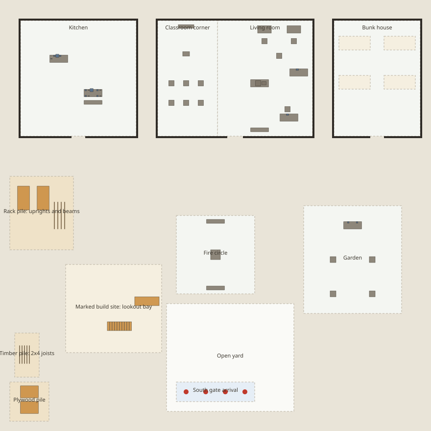

# Eden camp: the place for the live Mars world

Integration currency (2026-10-03): the camp is live at `/w/mars`, with four
Gene-owned Souls, a paused `/l/mars` snapshot preset, living resource renewal
and four finite construction cards. The helper's source scenario inventory and
12-test receipt below are retained as authored-scene evidence. Sections saying
lead wiring is absent or supplies never renew describe the isolated scenario,
not the integrated host. Current behavior: [STATUS](../../../docs/STATUS.md),
[runbook](../../../docs/sim/RUNBOOK.md), `worlds/mars/world.json` and the adapter.
The later workshop/library closing unit is published in the Lab; the persistent
camp still does not run its composites as routines.

Plan 22 §5 phase 3.2. This is a plain camp of about 42 × 42 m (scene bounds 44 × 44 m). It is built only
from the Mars engine's existing fixtures, items, regions and construction components, and every activity
example listed here is checked by the engine's own plan validation. Source:
`mars/viewer/engine/scenarios/eden-camp.ts`. Tests: `mars/viewer/engine/test/eden-camp.test.ts`.
Generated here: `manifest.json` (the affordance manifest) and `plan.svg` (a top-down plan). A test
fails if either file falls out of date.

## Export API (`scenarios/eden-camp.ts`)

| Export | What it is |
|---|---|
| `edenCampWorld(seed?: string): WorldState` | The camp at genesis: tick 0, no humans. `base.campus = 'eden-camp'`. `seed` (default `'eden-camp'`) changes only `world.rng`; ids and geometry are the same for every seed. Each call returns a fresh copy. |
| `EDEN_CAMP_SCENE`, `edenCampScene()` | The static `SpatialScene`: ground plus 2.6 m walls with door gaps. Register it as `servicesFor({ [EDEN_CAMP_CAMPUS]: EDEN_CAMP_SCENE })`. |
| `EDEN_CAMP_CAMPUS` | `'eden-camp'` |
| `CAMP_ARRIVALS` | Four clear arrival points at the south gate, `(-3,18) (-1,18) (1,18) (3,18)`, each with a yaw facing the fire. Seed Souls here, e.g. `human(id, p[0], p[1], { yaw })`. |
| `edenCampManifest()` | The machine-readable affordance manifest (schema `eden-camp-affordances/1`), the same data as `manifest.json`. |
| `edenCampActivities()` | `CampActivity[]`: one example per playable activity. Each has `id`, `label`, `verb`, `region`, `roles`, `params` with `$role` placeholders, `needs` (`energy`/`hunger`/`company`/`restlessness`, each +1 or −1), `tags`, and optionally `requires` (plain text), `after` and `effect`. |
| `bindCampActivity(activity, { role: actorId })` | Replaces `$role` in strings and in object keys (the classroom `departure` map). Throws if a role is missing. |
| `campActivityPlayable(rt, activity, roles)` | Checks whether the activity could start **now**, without submitting it: the schema, the verb's own `plan` (every physical precondition) and the current reservation holders. Returns `{ ok }` or `{ ok: false, diagnostic }`, and throws if a plan changes the world. Use it to decide which cards are playable. |
| `bindCampChess(world, white, black)` | Binds the two chess players in the board config. The board starts unbound and refuses moves with `chess.wrong-player` until this is called. |
| `CAMP_BUILDINGS`, `CAMP_DOORS`, `doorPoints(door)`, `CAMP_SPOTS`, `CAMP_MATS` | Building rectangles, doors (inside and outside standing points 1.2 m from the door centre), named standing spots, and sleeping mats. |
| `CAMP_BUILD_SITE`, `LOOKOUT_BEAMS`, `LOOKOUT_JOISTS`, `LOOKOUT_SHEETS` | The geometry of the construction blueprint. |
| `edenCampPlanSvg()` | Renders `plan.svg`. |

### What is in the camp

- **Kitchen** (x −20…−8, z −20…−8, door on the south side at x −14, 1.4 m wide). A prep counter holds
  `supper-pot` (empty) and `beans-bowl`/`greens-bowl` (full), plus `prep-spoon`. A dining table holds
  `stew-pot` (full), `bowl-1…4` and `spoon-1…4`. A three-seat `dining-bench` stands beside it.
- **Living room** (x −6…10, door at x 2, 1.6 m wide). Its west part is the **classroom corner**:
  `class-display` (on/off with text), `class-lectern` (with a presenter place) and `class-seat-1…6`.
  The east part has `computer-1`/`computer-2`, each with its chair, a `listening-chair`, a `chess-table`
  (board, tray, 32 pieces), a `reading-table` with `camp-book` and `reading-chair`, a `drawing-table`
  with `sketch-pad` and `sketch-pencil`, and a `living-bench`.
- **Bunk house** (x 12…21, door at x 16.5). Ground mats `mat-1…4` (regions of kind `work-area`, used
  by `sleep`).
- **Fire circle**: `campfire` (eight fire-circle places) and `fire-bench-north`/`fire-bench-south`.
- **Garden**: `garden-table` holds `water-bowl` (water 1.0) and `seed-bowl` (seeds 0.5). There are four
  raised planters, `planter-1…4`, each with garden-care and planting state.
- **Yard**: open ground, the arrival strip, and the material piles: `rack-pile` (`upright-a`/`b`,
  8 ft; `beam-1…4`, 9 ft), `timber-pile` (`joist-1…5`, 6 ft 2x4s) and `plywood-pile` (`sheet-1`/`2`, 4x6).
  The marked `build-site` has the delivered `lookout-stair` (10 treads) and `tread-1…10`.
- **Regions** (16): rooms are `place`, piles are `material-pile`, the build site and mats are
  `work-area`, the yard is `walkable`, the arrival strip is `staging`.

### Activity examples (75; 34 playable at genesis)

These are individual activities, not sequences. `after` names the examples whose completed effects
create the precondition. The tests use `after` to stage that state. It is not a schedule: hosts decide
when and whether anything is played.

- Anywhere: `walk_to` (fire, kitchen), `ambient_wander` (yard), `converse` (yard, living room),
  `group_warmup` (one instructor and three followers, yard).
- Fire: `campfire_circle`, `sit` on a fire bench.
- Kitchen: `prepare_food` (one finite batch); `put_item` to return the prep spoon, because the cook
  keeps it in hand; `shared_food_break` (two people, stew); and a one-person sequence of single
  primitives: `take_item` bowl, `walk_to` the pot, `serve`, `take_item` spoon, `eat`, then `put_item`
  for the bowl and the spoon. Also `sit` at the dining bench.
- Living room: `work_at`, `computer_music` (with one seated listener), `read_book`, `chess_move`
  (needs `bindCampChess`), `drawing_work`, `sit`, `converse`.
- Classroom corner: `classroom_session` (host, one presenter, two audience) and `display_control`.
- Bunk house: `sleep` on each of the four mats.
- Garden: `garden_care` (planters 1 and 2) and `seed_planting` (planters 3 and 4).
- Construction, the **lookout bay**: `carry` the uprights, beams, joists and sheets from the piles;
  `raise_upright` ×2 (one person holds each 8 ft frame); `connect_beam` ×4 (two people; 0.5 m and
  1.8 m on both columns); `release_support` ×2; `install_joist` ×5; `install_plywood` ×2;
  `install_stair_flight`; `install_tread` ×10; then `walk_to` up onto the deck (level 4).

## Assumptions

- Souls are seeded by the lead at `CAMP_ARRIVALS`. The camp contains no human. Soul ids must not
  collide with entity ids: every id is listed in `manifest.json` (fixtures, items, components;
  chess-piece ids look like `white-pawn-e2`).
- The lead registers the scene under `world.base.campus` (`'eden-camp'`). `world.json` (lead-owned)
  still names `proving-ground`.
- `world.env` keeps `emptyWorld`'s default date and time. The lead's clock owns time of day.
- There is no timetable, routine object, schedule or driver anywhere in the camp. The computer-workshop
  and library-reading composites are not used. The `living_intention`, `purposeful_routine`,
  `gathering_continuation` and `room_preparation` verbs do not appear in any example (a test checks this).
- Provenance is `design-edit` / `hypothetical`. This is an authored camp, not a reconstruction.

## Validations actually run

Command: `cd mars/viewer && node --test engine/test/eden-camp.test.ts`. It passes 12/12 in about 13 s.
`tsc --noEmit` (the whole viewer project) and `oxlint` on both files are clean. The engine's
`source-scan`, `scenario-contracts` and `env-sun` tests also pass with the new files present.

1. **Genesis**: no humans, tick 0, and a pinned `hashOf(world)` = `f60cf9fd…1cc24`. Two builds hash the
   same. A different seed changes only the RNG: same ids, and `physicalView` is equal apart from `rng`.
   `base.staticHash` equals the scene hash, and the exported scene is never mutated.
2. **References**: every entity def is in the catalog, every surface support and slot exists, and
   everything lies inside the bounds. Every id, slot and region in every example resolves; roles are
   declared and used; `after` ids exist; verbs are registered.
3. **Walls and doors**: each door is passable. With the door gap closed by an added wall, the route
   from outside to inside **fails**, so each building has exactly one opening (five wall segments
   each).
4. **Routes**: there is a route from each of the four arrivals to all 21 named spots, and between every
   pair of room hubs (kitchen, classroom, living room, bunk house, fire, garden, build site, piles).
5. **Genesis playability**: all 34 examples without `after` pass `campActivityPlayable` for Souls
   standing at the arrivals, and the check leaves the world hash unchanged.
6. **Chess**: an unbound board refuses with `chess.wrong-player`. Once bound, e2–e4 executes and it
   is black's turn.
7. **Kitchen, executed**: `prepare_food` fills `supper-pot` to 0.5 and empties both ingredients; the
   cook returns the spoon. One person takes bowl-3, walks to the pot, serves, takes spoon-3, eats, and
   puts both back in their original slots. Two others then share a meal, which leaves `stew-pot` at 0.25.
8. **Meal repeats**: the shared meal runs twice (s1+s2, then s3+s4) with the same utensils. The pot
   ends empty, and a third meal is refused.
9. **Social, executed**: display on; a full classroom session (shortened phase seconds); a warm-up of
   three cycles; computer music with a seated listener; two people reach `warm` at the fire, then the
   circle is cancelled cleanly.
10. **Garden, sleep, seated, executed**: watering (cycle 1, water 0.75), sowing, all four mats slept on
    (with a shortened duration), reading, computer work and drawing.
11. **Construction, executed**: all 40 `build.*` examples in dependency order, each checked with
    `campActivityPlayable` immediately before it is submitted and each run to completion, using Souls
    who are free and on the ground. About 600 simulated seconds, with no invariant violation. All 24
    components end `installed`, and one Soul stands on the deck (level 4). A **fresh Runtime built
    from that WorldState alone** keeps everything installed and has no violations, as daily compaction
    requires. `prepare_food`, `shared_food_break` and `garden_care` are still playable after the stair
    exists.
12. **Files**: `manifest.json` and `plan.svg` equal the generated output. Every fixture lies in a
    named region, and every component lies in its pile or on the build site.

Regenerate the files: `cd mars/viewer && UPDATE_CAMP_MANIFEST=1 node --test engine/test/eden-camp.test.ts`.

## Limitations (honest)

- **Everything is finite, and nothing refills it.** `stew-pot` gives four servings of 0.25 each.
  `supper-pot` is filled once (to 0.5) from the two ingredient bowls. `water-bowl` gives four waterings
  of 0.25. `seed-bowl` (0.5) sows two planters. Garden care is due again only after 600 ticks. After
  the first day, food and water run out unless the lead adds restocking, for example a world edit at
  first light. The engine has no refill verb.
- **`shared_food_break` is fragile in traffic.** It fails with `shared_food.interrupted` when a
  participant is asked to make way. It treats the walk it is sent on as an outside command, even when
  the other participant asked for it. This happens when the idle partner stands where the other must
  walk. Example: the same two people repeat the meal straight away with their roles swapped, so they
  start from their stow places. From the arrivals it completed for all 12 ordered pairs. The layout
  reduces the problem: the first server takes the east place, and both eat north of the table, away
  from the door. Cards should treat this failure as retryable. The real fix belongs in the engine.
- **`prepare_food` and `shared_food_break` require a ground-only scene.** They are still playable after
  the lookout stair exists (checked), because its link is not part of the base scene.
- **Chess needs bound players** (`bindCampChess`) before any move. Promotion is not supported by the
  engine.
- **The fire has no lit or unlit state.** "The fire being lit" can only be a world event or a custom.
  `campfire_circle` runs until it is cancelled.
- **`sleep` is capped at 600 s per call** by the schema. A night of sleep means calling it again. All
  four mats are inside the bunk house.
- **Construction is one blueprint** (the lookout bay). The stair flight and its treads are delivered
  next to the site, because the engine does not model carrying stair modules. Once the frame is
  released, the bay cannot be taken apart: the engine has no dismantling verbs. It stays built, as
  intended.
- **`computer_music` allows at most two listeners**, and the camp has one listening chair. The class
  example has two audience members; there are six seats.
- **No Lab preset is wired** (`/l/mars?scenario=camp`). Lab registration, the server, cards and the
  `world.json` scene are lead-owned shared wiring, which this task did not touch.

## Integration notes for the lead

1. Register the scene: `servicesFor({ [EDEN_CAMP_CAMPUS]: EDEN_CAMP_SCENE, ... })`. Then build the world
   with `edenCampWorld(seed)`, add the Souls at `CAMP_ARRIVALS`, and call `bindCampChess(world, a, b)`
   if chess cards are offered.
2. Cards: one per `CampActivity`. A card's condition is `campActivityPlayable(rt, activity, roles)`,
   and its depiction is the verb. Use `needs` and `tags` to weight the chooser. Treat `requires` as
   text for the prompt.
3. Long `duration` values in the examples (work 240 s, reading 240 s, sleep 600 s, music 120 s) are
   suggestions. The schemas allow other values.
